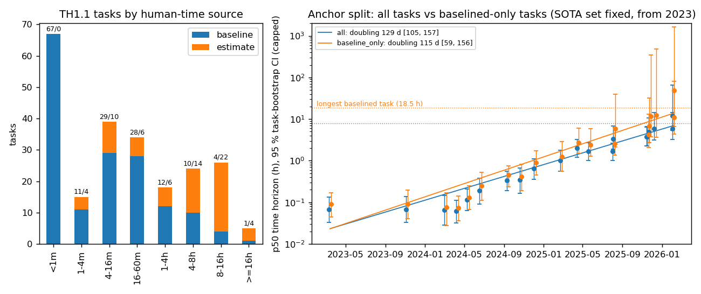

# metr-horizon-anchors

**How much do METR's AI "time horizons" depend on human task times that were estimated rather than measured?**

METR's Time Horizon 1.1 (TH1.1) summarises each AI model by its *50% time horizon*: the length of task, in human
working time, that the model completes with 50% probability. Each task's human time is either a **measured human
baseline** or a **researcher estimate**. This pilot asks how much the headline numbers rest on the estimates.

Independent secondary analysis of METR's public data by Thomas Chisica. Not affiliated with or reviewed by METR.
**Status: exploratory pilot (8 Oct 2026).** A pre-registration for a confirmatory analysis is in draft; it will be
filed on OSF before that analysis is run.



## Findings (exploratory; every number is reproduced by `./run.sh`)

1. **Exact replication.** METR's public code and runs file at commit `52cb829` (24,008 runs, 228 tasks) reproduce
   the published p50 for all 20 models in the file (relative difference 0, to 6 decimals) and the 128.7-day doubling
   time since 2023. METR's own DVC pipeline gives the same fits.
2. **Where the measured anchors are.** 162 tasks have a measured human baseline and 66 a researcher estimate. Of the
   31 tasks of 8 h or more, 5 are measured and 26 estimated. The longest measured task is 18.5 h.
3. **Measured anchors only.** Every model's p50 rises. For the top model in the file (Claude Opus 4.6) it goes from
   12.0 h to 48.6 h, beyond the longest measured task, with an unbounded upper CI: its level is no longer identified.
   The doubling time moves little (paired ratio 0.88, 95% CI [0.50, 1.15], with METR's SOTA rule).
4. **Reading.** Levels and threshold-crossing dates are fragile to the estimated anchors; the slope is not. Limits
   are in `PILOT-MEMO.md` §9; for example, dropping estimated tasks also changes the task mix.

Details, tables and kill criteria: [`PILOT-MEMO.md`](PILOT-MEMO.md).

## Reproduce

```bash
./run.sh   # about 4–5 min on a laptop, CPU only
```

- `setup.sh` clones `METR/eval-analysis-public` at the pinned commit `52cb829`, checks the sha256 of `runs.jsonl`,
  downloads `metr.org/assets/benchmark_results_1_1.yaml`, and builds `.venv` with the versions pinned in
  `requirements.lock.txt`.
- The published file is checked against its 2026-10-08 sha256. If METR has changed it since, `setup.sh` warns and
  the replication gate compares against the current file.
- All fitting uses METR's own functions (`horizon.wrangle.logistic`, `horizon.wrangle.bootstrap`, …). The only patch
  is a stub for `cairosvg`, which METR imports only to draw its logo.

Scripts: `01_replicate.py` (replication gate), `02_anchor.py` (anchor split, sensitivity to the scale of the
estimates), `03_k4_and_diagnostics.py` (run-encoding check, implied scale factor), `04_figures.py`.

## Data, licence and AI use

- METR's repository has no LICENSE file, so **none of METR's code or data is redistributed here**. That includes the
  per-task table, which `./run.sh` regenerates locally. See [`NOTICE`](NOTICE).
- Original code and text: MIT ([`LICENSE`](LICENSE)).
- Built with an AI coding assistant (Anthropic's Claude, through Claude Code) in sessions directed by Thomas Chisica.
